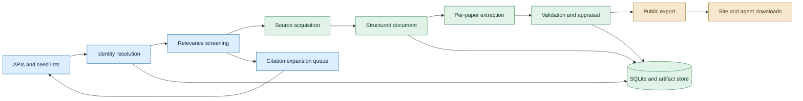

# JEPA research landscape

Design snapshot: 2026-11-07. Implementation has begun; [README.md](README.md) and [OPERATIONS.md](OPERATIONS.md) track executable capabilities and limits. This document preserves the intended design, including work not yet implemented. Provider details are sourced in [research](research/).

## Confirmed direction

- Public GitHub repository and public site at **jepa.toni.foo**, linked from the personal site's `/cool` directory.
- Broad coverage of JEPA and related research: predictive representations, action-conditioned dynamics, world models, predictive VLA/robotics, generative world models, physics-informed simulation and system identification. Adjacent work needs an explicit connection, not necessarily the word JEPA.
- Continuous acquisition and curation. No fixed-size corpus, mandatory pilot, or staged corpus release. Individual records become publishable as they satisfy their checks; discovery keeps running alongside processing.
- Runs start manually and have an explicit time budget. Measure actual throughput and Codex Pro usage; Anton can authorize another block, such as 20 hours. No automatic schedule initially.
- Use the selected Codex Pro account and small/low-thinking models through Pi's provider runtime. Treat subscription capacity as the intended large-scale resource, not a hypothetical per-token dollar budget. Actual provider throttling still applies; do not rotate accounts or silently switch to paid API billing.
- Honor free quotas on external APIs, particularly OpenAlex. The credential location was supplied during implementation; secrets remain outside the public repository.
- Cross-paper scientific analysis, discovery of research gaps across the corpus, and generated synthesis are **out of scope**. Citation edges, search indexes, taxonomy and per-paper appraisal are in scope.

## Architecture

A small Python pipeline owns data and orchestration. A TypeScript adapter owns model calls through Pi. A statically generated React site consumes a public export, never the private processing database.

SQLite with WAL, foreign keys and FTS5 is enough initially. Workers lease jobs transactionally; artifacts are immutable files addressed by SHA-256. No Neo4j, vector database, Redis, Kafka, LangChain or distributed workflow platform is needed to begin. Citation edges fit an ordinary indexed table.

## 1. Discovery without pretending to cover everything

Use provider APIs rather than general HTML scraping where possible. Every adapter emits the same source-record envelope: provider ID, identifiers, title, authors, dates, abstract if permitted, URLs, license signals, raw-response hash, query/run ID and retrieval time.

| Source | Role | Decision |
| --- | --- | --- |
| arXiv | Keyword discovery, historical coverage, versions, source/PDF acquisition | Primary; overlapping update windows and cached historical searches |
| OpenAlex | Forward/backward citations, DOI resolution, broad metadata | Primary graph; explicit free-budget accounting |
| Hugging Face Papers | Daily/community discovery and model/dataset/code links | Use documented OpenAPI endpoints; attention is not quality |
| alphaXiv | Additional discovery and ranked feeds | Official MCP adapter when access is configured; request original extracted text rather than its default AI report |
| Semantic Scholar | Complementary citations and identifiers | Supplement OpenAlex where coverage differs; respect its separate license and limits |
| OpenReview | Submissions, versions, public decisions and supplementary links | Retrieve relevant venue records; reviews are third-party commentary, not experimental ground truth |
| Crossref | DOI bibliographic metadata and deposited references | Enrichment, not a complete forward-citation graph |
| PMLR, CVF, ACL Anthology | Proceedings identity and artifact verification | Targeted venue adapters, not broad website crawling |
| Curated lists and primary lab pages | Discover missing seeds, technical reports and artifacts | Import links with provenance; verify against primary records |

Google Scholar has no supported general public API suitable for this pipeline. Do not build a CAPTCHA-bypassing Scholar scraper; use OpenAlex/Semantic Scholar and primary reference lists instead. An optional manual Scholar check must not become a hidden dependency.

**Scope is a relation, not a keyword test.** Query named JEPA variants plus mechanism terms: joint-embedding prediction, predictive latent state, action-conditioned dynamics, planning in learned models, interactive video simulation, predictive VLA, physical dynamics and neural operators. Preserve the query bank and adapter-specific query translations in version control.

Maintain relevance labels `direct`, `adjacent`, `context`, `excluded`, and temporary `uncertain`, plus multiple topic labels. A generic robot policy, video generator or PDE solver requires an explicit reason to enter the adjacent corpus. Store exclusion reasons; audit samples of exclusions to measure missed relevant work. Failure to obtain full text is not an exclusion.

The [seed proposal](research/scope-and-quality.md#anchor-proposal-22-works) supplies 22 starting points. Add original [V-JEPA](https://openreview.net/forum?id=QaCCuDfBk2), [LeJEPA](https://arxiv.org/abs/2511.08544) and [DINO-WM](https://arxiv.org/abs/2411.04983). Reconcile source versions before extracting. The [CNC paper raised by Anton](https://arxiv.org/abs/2609.16071) is an appraisal test case, not a preassigned low-quality label.

Citation expansion is a resumable frontier. Start with references and citing papers around accepted relevant works; screen each new candidate before recursively expanding it. Keep per-source pagination cursors, hop depth, seed lineage, sort order and unvisited edges. Allocate finite work per run across direct JEPA, recent results and adjacent branches so prolific branches cannot starve others. A run limit delays edges rather than permanently dropping them. Do not select only highly cited papers. Report truncated coverage, missing graph matches and provider disagreements.

No source establishes exhaustive coverage. Publish a coverage manifest listing searched sources, date windows, query families and outstanding queues, without marketing the corpus as complete.

## 2. Identity and versioning

Mint a permanent internal UUID for each work, independent of title, DOI and discovery provider. Human-friendly slugs may change; public UUID URLs do not.

Separate:

- **Work:** the scholarly contribution being catalogued.
- **Manifestation/version:** arXiv v1/v2, conference publication, accepted manuscript, supplement or correction. A result always points to the exact inspected version.
- **Source record:** what a provider asserted about an identity at a retrieval time.
- **Artifact:** exact downloaded or derived bytes, identified by hash.

Use deterministic matching first: normalized arXiv IDs with legacy forms handled, normalized DOI, provider mappings and explicit canonical links. Strip version suffixes for grouping, never from the version record. Cross-identifiers supplied by aggregators remain assertions that can conflict.

Only ambiguous candidate pairs go to AI. Generate candidates using title/author similarity and explicit links; the model compares evidence and returns `same_work`, `related_work`, `different_work` or `unresolved` with reasons. Embeddings or similar titles alone never authorize a merge. High-risk/conflicting cases stay separate pending review. Preserve a reversible merge/split log and redirects; do not rewrite past evidence IDs. Extensions, follow-ups, corrections, retractions and duplicated publications need typed relationships rather than forced identity.

## 3. Source acquisition and document parsing

Acquire the exact version's LaTeX source tree and PDF when available, plus official HTML and relevant supplementary files. Retain the authoritative bytes before conversion. An arXiv source response may be a tar archive, compressed single file, PDF or failure page; validate format and version.

Use native HTML for reading order and anchors when version-matched; retain LaTeX for equations, tables, bibliography and provenance. Inspect include graphs, root files and macros. Use LaTeXML only when needed, rather than recreating a TeX parser. Source line ranges are not PDF page numbers.

For PDF-only or incomplete-source cases, start with **Docling JSON and Markdown**. Keep page/bounding-box provenance where available. Compare an alternative such as Marker or olmOCR on naturally occurring difficult pages before adding a second permanent parser. GROBID is optional for references/citation contexts, not a substitute for numerical table extraction. Detailed tradeoffs and license caveats are in [content-extraction.md](research/content-extraction.md).

Use vision-capable model calls on selected table/figure crops to resolve difficult evidence. Preserve raw extraction and corrected text separately. Do not regenerate a whole PDF as fabricated LaTeX merely for format uniformity. The normalized document should represent sections, paragraphs, equations, tables, figures, captions, references and appendices with stable block IDs and original locations.

Run parsers in isolated workspaces. Reject archive traversal, escaping symlinks, archive bombs and unsafe file counts/sizes. No TeX shell escape, executing downloaded paper code, arbitrary model-directed shell commands or access to credentials. Apply CPU, RAM, disk and wall-time bounds. Network acquisition is a separate controlled capability with URL/redirect checks that prevent access to private services. Source text is untrusted data and cannot alter worker instructions.

## 4. Structured per-paper research record

Use a versioned Pydantic schema and generated JSON Schema. Store records as structured JSON, not prose blobs with a few tags.

| Group | Fields and intended distinction |
| --- | --- |
| Identity and scope | Bibliography, versions, publication/withdrawal/retraction status, relevance rationale, topics, task and modality |
| Research questions | Questions actually investigated; author-stated versus reconstructed from the paper |
| Contribution and claim ledger | Claimed novelty, concrete method/theory/artifact contribution, positive and negative findings; claimed novelty is not independently established novelty |
| Mechanism | Inputs, prediction target/space, conditioning, horizon, encoder/teacher/predictor, loss, stop-gradient/EMA, anti-collapse, planning/inference procedure, privileged information |
| Assumptions | Observability, determinism/stochasticity, action availability, stationarity, physical constraints and other applicability conditions |
| Theory | Definitions, assumptions, theorem/proposition statements, proof availability and claimed consequences; AI inspection is not proof certification |
| Experiments | Interpretation of each experimental question, a few decisive numerical results, relevant baselines/conditions and caveats, linked to exact source tables/LaTeX |
| Artifacts | Paper/supplement, code, weights, datasets, configs, logs, JSON/CSV results, simulator and evaluation scripts; versions/commits, licenses, accessibility and hashes when retrieved |
| Limitations | Author-stated limitations separately from analyst-inferred limitations, each linked to its basis and scope |
| Future work | Explicit author proposals, distinguished from analyst suggestions |
| Hypotheses | Author conjectures and explicitly marked single-paper analyst hypotheses; evidence, falsifying test and expected observables, without a claim of novelty |
| Retrieval views | One-sentence takeaway, short summary, technical summary, controlled keywords, method aliases and task/dataset/metric names |
| Appraisal | Rubric dimensions, evidence references, quality score when supported, extraction status and review history |

Every substantive statement needs one or more evidence records: artifact hash, exact version, source file/line or block ID, section/table/figure label, PDF physical page and box when available, original text/value and normalized interpretation. State whether the evidence is source text, author-supplied artifact, third-party commentary or analyst inference. Public quotes require the publication-rights check below; internal evidence need not be copied publicly.

### Experiments should explain the findings

**Anton clarified the output on 2026-11-08:** collect textual interpretation and the main numerical results, not a full transcription of a paper's thirty-row tables. Original LaTeX/HTML/PDF is the detailed reference.

Each experimental finding states what was tested, what the evidence supports, the few decisive numbers, comparison conditions and caveats. Select representative results for the finding, normally one to three, rather than emitting every baseline/ablation cell. Important negative findings must survive selection. Cite exact source table/figure/section and version. A selected numeric result retains method, dataset, metric, value, protocol and qualifiers when reported; training-label budget must not be mislabeled as an evaluation split.

Keep a private coverage inventory of experimental sections, tables, figures and appendices, with complete/partial/inaccessible/unresolved states. Coverage means the experimental findings were considered, not that every cell was copied. Public pages present findings and source links; existing detailed transcription records stay private. Preserve an explicit partial status where source/figure/supplement coverage is uncertain. Never invent raw logs, curve values or supplementary data.

An artifact's availability states are distinct: `linked`, `reachable`, `downloaded`, `inspected`, `executed`, `reproduced`. This project initially retrieves/inspects permitted artifacts; it does not reproduce experiments or run third-party code. Never promote availability to reproducibility.

Use explicit null reasons: `not_reported`, `not_applicable`, `unavailable`, `ambiguous`, `not_yet_extracted`. Conflicts between paper, appendix and repository remain visible. Missing evidence is not a negative experimental result.

## 5. AI execution: scripts by default, bounded agents when useful

Reuse Pi's **ModelRuntime** and existing Codex provider, not a home-grown OAuth client. A ChatGPT/Codex subscription credential is not an ordinary `OPENAI_API_KEY`; it must use the supported Codex provider path. Public code accepts configurable provider/model selection without bundling personal auth files, account labels, private imports or machine-specific paths. Validate the installed Pi adapter before processing live papers.

Use three levels:

1. **No-model transforms:** IDs, hashing, download validation, pagination, schema validation, citation-location resolution and numeric parsing.
2. **Tool-free structured calls:** abstract relevance, ambiguous identity comparisons, section-level extraction and summary generation. Validate output locally; do not assume provider-native strict JSON is available.
3. **Bounded document agents:** difficult tables, cross-references within a paper, missing method details and artifact inspection. Expose only `read_blocks`, `search_paper`, `view_page`, `read_artifact` and `submit_record`. No ambient shell, general web browsing, credential reads or arbitrary filesystem access. A controlled fetcher resolves approved public artifact URLs outside the agent.

Do not run a fully loaded personal Pi agent for each paper. No inherited personal memory, extensions or unrelated tools. Freeze the resolved model/profile and prompt versions per job. Use the configured small profile for bulk work, with a low-thinking normal profile for difficult records only when useful; avoid hardcoding transient model aliases.

Document processing loop: inventory → extract section evidence and experiment items → reconcile within this paper → check source grounding → appraise → derive summaries from the validated record. These are separate job types so a parser correction does not require repeating discovery. Within-paper reconciliation is permitted; corpus synthesis is not.

Validation checks schema, actual evidence resolution, quote matches, version alignment, required result qualifiers and unprocessed inventory items. A second model can challenge evidence, but agreement between two models is not verification. Track separate flags for `schema_valid`, `location_resolved`, `source_support_checked` and `human_reviewed`.

Give each call explicit token/output limits, timeout and bounded repair attempts. A repair gets the failing fields and original evidence; after the cap, retain a partial record and queue review. Never silently truncate long papers. Partition by sections/experiments and retain a document-wide inventory with missing chunks visible.

## 6. Quality that helps later agents allocate attention

Maintain three independent axes:

- **Relevance:** connection to this landscape.
- **Evidence quality:** how well the paper supports its claims.
- **Extraction confidence:** how faithfully this database represents the sources.

For empirical work, propose five anchored dimensions, each scored 0–4 with cited reasons:

| Dimension | Weight | What is assessed |
| --- | ---: | --- |
| Claim support and experimental design | 30% | Tests actually address the claims; measurement validity and uncertainty |
| Comparisons and causal attribution | 25% | Appropriate baselines, matched conditions, ablations and confounds |
| Generalization and robustness | 15% | Evidence appropriate to the claimed scope; shift/rollout tests where claimed |
| Reproducibility and reporting | 15% | Sufficient specification and inspectable artifacts, without pretending code was run |
| Calibration of conclusions | 15% | Abstract/conclusion match results; limitations and negative findings represented fairly |

Provisional aggregate: `100 * sum(weight * dimension_score / 4) / sum(assessed_applicable_weights)`. Publish assessed-weight coverage alongside it; with less than 80% of applicable weight assessed, show `unrated` rather than a misleading score. Distinguish a known reporting omission from a source we have not inspected. Every excluded/inapplicable dimension needs a reason. These weights and the coverage threshold are proposed policy, not scientifically validated measures; version them and calibrate against reviewed examples during ordinary operation.

Theory-only work needs a separate rubric covering statement precision, assumptions, argument/proof inspectability and scope. Do not punish it for lacking experiments or rank different rubrics as though interchangeable. Do not claim model-generated proof checking is formal verification.

Low scores remain in the corpus with visible reasons such as unmatched baseline budgets, unsupported generality, leakage risk or contradiction between the abstract and table. Agents can filter or downweight them, but the default export does not silently delete relevant negative results. A useful negative finding can score highly. Poor abstract style alone is not a scientific quality verdict. Avoid public insults; use precise evidence-backed flags and a correction history.

Default assessments are explicitly AI-generated and provisional. Mechanical validation is not human review. Unknown quality must not automatically sort below confirmed weak evidence. Citations, venue prestige and social votes are separate metadata, not components of the scientific score.

## 7. Continuous operation and measurement

Use independent resumable queues for discover, resolve, screen, acquire, parse, extract, validate, appraise and publish. Job identity includes work/version, input hashes and stage/prompt/parser/schema versions. Cache completed identical jobs; new paper versions or prompt changes invalidate only affected outputs.

A run has a start time, hard stop deadline, selected account/model configuration, concurrency limit and provider budgets. Reserve cleanup time within the authorized duration; lease only work whose bounded call timeout fits the remaining window. At cutoff, abort outstanding requests and checkpoint unfinished jobs, recording unknown remote completion/usage rather than claiming cancellation guarantees zero further provider work. No extra processing grace period unless authorized. Restarting resumes unfinished jobs instead of redownloading the corpus. Do not describe a queued job as completed.

Retry only classified transient network/provider errors with capped backoff and `Retry-After`; provider auth failures, schema bugs and exhausted retries become visible blockers. Keep persistent quota accounting across runs with each provider's reset timezone, request costs and observed usage headers. Account for other clients using the same key by refreshing authoritative usage where available; otherwise use a conservative configured allocation and mark remaining quota unknown. Do not infer that our local request ledger equals total account usage. When an API's free quota or our conservative allocation is exhausted, pause that adapter until reset while independent queues continue. Retain a valid previous public export if a new one fails checks.

Every run emits a receipt: new unique candidates, merge decisions, relevance counts, documents acquired, extraction completeness, published records, unresolved failures, provider requests, input/output/cached tokens when returned, model calls, wall time and throughput per worker. For subscription calls, token counts are workload measurements, not fabricated dollar charges. Record quota snapshots only if the provider actually exposes them, plus throttle events; Anton's observed subscription consumption remains part of the decision to run longer.

Increase concurrency based on measured throughput and throttling, not an assumption that more agents are free or faster. Keep a rolling sample of raw-to-record audits, exclusion audits and difficult extraction fixtures as normal processing continues. These checks do not create a separate pilot stage or halt all curation for a fixed benchmark corpus. Human evaluation is selective; papers without it retain their explicit AI-only status.

## 8. Human and agent access

**Default view:** a compact searchable catalogue, not an unreadable all-corpus graph. Filters cover relevance, topic, prediction space, conditioning, modality, task, data/code availability, year, evidence quality and extraction completeness. Search method aliases as well as paper titles.

**Paper page:** research question and takeaway; method/objective; contribution claims; experiment tables; limitations/future work/hypotheses; artifacts; appraisal with expandable reasons. Every claim or number opens its evidence locator and permitted source link. Public records need version-specific source URLs plus usable section/table/page locators, not private artifact hashes or inaccessible internal block IDs alone. If public source access cannot be established, mark the claim's evidence as not publicly inspectable rather than implying independent public verification. Display version and AI/human review status where they affect interpretation, without decorative dashboard clutter.

**Graph view:** a selected paper's local citation neighborhood and declared method/topic links, using Cytoscape.js. Distinguish observed citations, author-declared relationships and classifier topic labels. No inferred influence, agreement, contradiction or research-gap edges. A citation alone does not establish intellectual dependence.

**Agent interface:** versioned JSON/JSONL exports, JSON Schema, per-paper Markdown, citation-edge export and a manifest with hashes. Agents can retrieve by stable ID and filter before loading full evidence. Include structured quality/relevance/provenance fields so later analysis need not scrape HTML. Large releases belong in downloadable dataset assets, not an ever-growing Git history of PDFs.

Start with static full-text search such as Pagefind over generated summaries/method fields and a structured facet index. Local agents use SQLite FTS5. Add semantic retrieval only if real queries demonstrate a gap; embeddings need a separately selected local model or authorized service, since Codex completion auth is not an embeddings API. Never ship restricted full text in a browser search index.

React/TypeScript with prerendered paper routes and a static build avoids an unnecessary public application backend. Reuse KaTeX/MathJax for math and Cytoscape.js for graph interactions. VibeMathed's MIT code is available if a specific component is useful; do not fork its full community stack. No accounts, votes, comments or public uploads initially; GitHub issues provide corrections.

## 9. Public boundary and deployment

Public repository: source, schemas, prompts, query/seed configuration, tests, methodology, allowed small sample records and publication tooling. Proposed licenses: MIT for project code, CC BY 4.0 for original catalogue annotations where rights permit. Imported metadata, abstracts, quotations, papers, figures, code and model weights retain their own terms; no blanket relicensing.

Private runtime: `.env`, OAuth credentials, raw responses containing sensitive request fields, operational logs, downloaded PDFs/TeX, restricted derived text and the working SQLite database. Redact API keys from URLs and exceptions. An arXiv distribution grant is not permission to republish the full paper. Preserve per-artifact/source rights and attribution; public export is allowlisted field-by-field, not a directory copy. Link original papers by default; redistribute source or figures only after an explicit license check. Store rights-review status and correction/takedown paths.

Build and test the public export separately from the worker. Public browsers and unauthenticated requests cannot initiate model calls, downloads or code execution. Publish atomically to `jepa.toni.foo` through the existing public hosting arrangement, retaining the previous build for rollback. Never expose private origin URLs, private disk paths or credential-bearing artifact links. If a new persistent serving process is necessary, give it a dedicated response-based health check; prefer existing static hosting capability otherwise.

Before first publication: review the exact export, scan Git history/build artifacts for secrets and private paths, check licenses/attribution, verify identifier redirects and evidence links, test search/filters/paper/graph/download flows on desktop and mobile, and verify the public hostname. Destination approval is recorded above; deployment details still require inspection of current infrastructure.

## Implementation order and completion checks

These are dependency order, not corpus stages. Once the loop exists, all queues operate continuously within manually authorized runs.

1. Define identities, evidence/schema contracts and job ledger; verify idempotence, version separation and reversible merges with adversarial fixtures.
2. Add arXiv/OpenAlex/Hugging Face discovery, source acquisition and quota controls; verify restart pagination, duplicate ingestion and credential redaction. Add alphaXiv when its auth is available, then complementary adapters without blocking the rest.
3. Connect the Pi model adapter and document parser; verify selected-account-only execution, long-paper inventory coverage, exact numeric/header grounding, incomplete-source behavior and safe parser isolation.
4. Add per-paper appraisal, search exports and static UI; verify no unsupported claims or restricted source bytes enter public output, and inspect representative records while production curation continues.
5. Publish the reviewed repository and site; report a first measured processing receipt. Further run duration is Anton's decision, not an automatic timer.

The difficult work we must build is the version-aware identity ledger, evidence/result schema, source-grounded extraction checks and continuous publication contract. Discovery APIs, model transport, document parsing, search and graph rendering should be reused.
